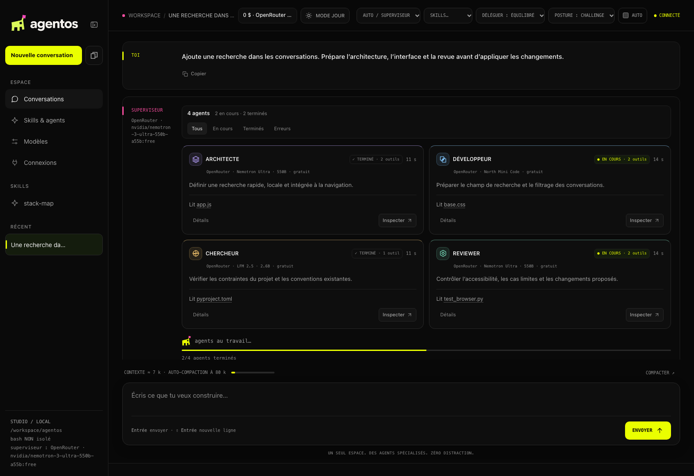
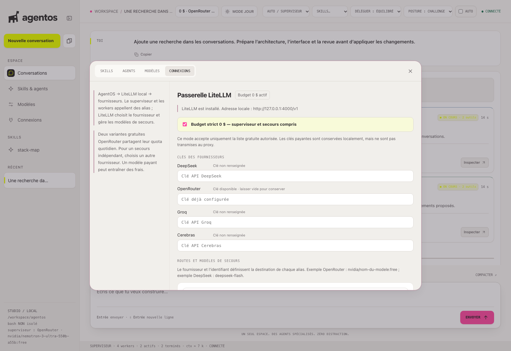
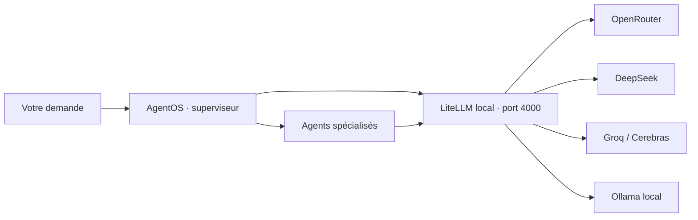
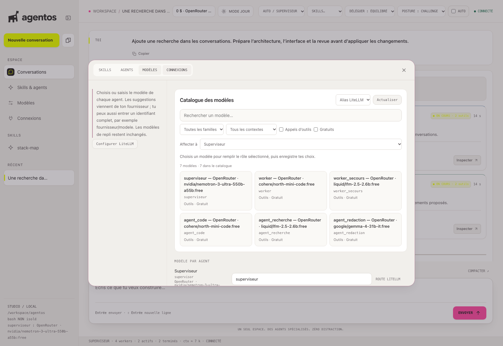
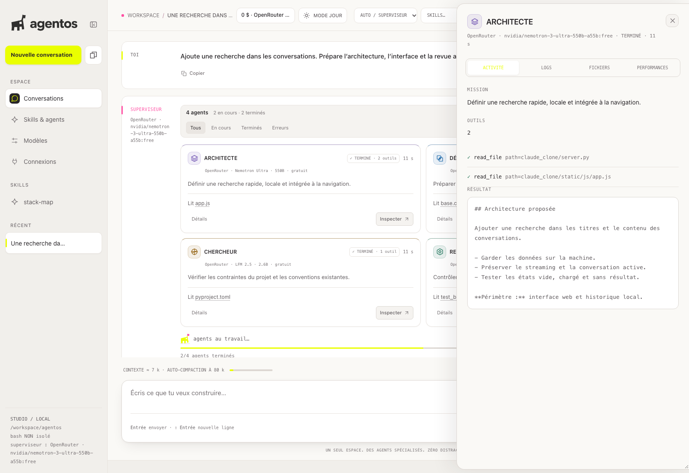
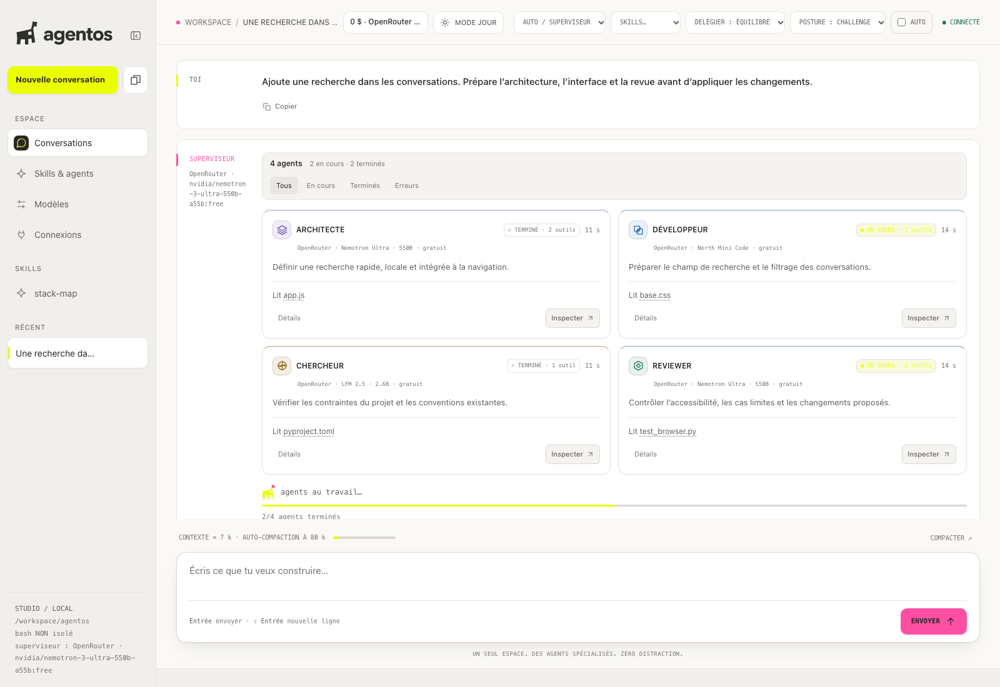

```text
               :*>>*~.
               :>>>>~
               ^[<>^-
              :#}~                                                   ~++-
       .:=><(}#%[-           ..:..     ..:. ...    .:..   ........  .<@%^.    .:..     ..:..
.~<[{{#%%%%{^~-##~         :]%@@@@#= :{%@@@#%@%..)%@@@@{+ ^@%{%@@@}-}@@@@@+:(%@@@@#*.-{@@@@%]-
+#%%%%%%%%%}~ .]%^         -)(..-}@}~}@%^..>%@%:(@%~..>@%+^@@[..)@@<.<@%*..#@#=.:]@%<)@%^:.^:
~{%%%%%%%%%%##%%%(         =}@@@@@@{*#@}.  -[@%-{@@@@@@@@<>@%+  *#@).<@%* =@@>.  -%@]~<#@@@%>:
.}%%%%%%%%%%%%%%%{.       .}@}. ~{@{~]@@{(({@@%:(@%=..+]*.^@%+  *%@) <@%<.:#@#+.-]@%<:(+.:(@#+
.[%%(~-->#%}=..[%%~        *%@@@#%@}- ~#%%%]}@%..)%@@@@%^.>@%+  *#@).:#@@@+:(%@@@@%+.>%@@@@%(.
-}%%>.  *#%}~  >%%>          ... ... -]^:..>%@(.   ....   ...    ...   ...    ....     ....
+~  :-..                 .^%@@@@@%>.
   .    ....                            ...
```

# AgentOS

**iDE locale pour vos agents de développement.**

Décrivez une tâche. Le superviseur la répartit entre des agents spécialisés, vous suivez leur activité et vous inspectez leurs résultats avant d’appliquer les changements. LiteLLM relie cette orchestration aux fournisseurs et aux modèles que vous choisissez.



*La vraie interface, avec un scénario de démonstration anonyme. Aucune clé API ni conversation personnelle dans les captures.*

[Démarrer](#démarrer) · [Comprendre LiteLLM](#comment-fonctionne-le-routage) · [Configurer les modèles](#configurer-les-fournisseurs-et-les-modèles) · [Budget gratuit](#budget-gratuit) · [Clés API et Git](#clés-api-et-git)

- **Des agents identifiables** : couleurs et symboles par rôle, états en direct, filtres et progression.
- **Des actions inspectables** : mission, outils, fichiers, rapports et durée dans un panneau dédié.
- **Vos choix de modèles** : catalogue, alias de routage et modèles de secours, configurables depuis le front.
- **Des changements à valider** : aperçus et diffs avant les actions qui nécessitent votre accord.
- **Deux interfaces** : le tableau de bord web et le terminal, sur la même orchestration LangGraph.

## Démarrer

Les commandes suivantes visent **macOS et Linux**. Sous Windows, utilisez **WSL2** pour ce parcours et les outils bash. Installez d’abord [Git](https://git-scm.com/) et [uv](https://docs.astral.sh/uv/getting-started/installation/). Le projet accepte Python 3.11 ou plus ; Python 3.12 est utilisé ci-dessous et pour l’environnement séparé de LiteLLM.

```bash
git clone https://github.com/woezyPi/agentOS.git
cd agentOS

uv python install 3.12
uv venv --python 3.12
source .venv/bin/activate
uv pip install -e .

cc-gateway --install
cc-web --open
```

`cc-gateway --install` installe le proxy LiteLLM dans `~/.claude_clone/litellm-venv`, séparément des dépendances d’AgentOS. `cc-web --open` démarre l’interface sur `127.0.0.1:8765` et ouvre le navigateur. Si l’ouverture automatique échoue, copiez **l’URL complète affichée dans le terminal**, avec son fragment `#token=…`.

Gardez le terminal du serveur ouvert pendant l’utilisation. Aucune clé n’est nécessaire pour ouvrir l’interface et accéder à la configuration.

### Premier lancement avec les modèles gratuits

1. Ouvrez **Connexions** dans la barre latérale.
2. Cochez **Budget strict 0 $ — superviseur et secours compris**. Les routes du profil gratuit sont remplies automatiquement.
3. Créez une clé dans votre [compte OpenRouter](https://openrouter.ai/settings/keys), puis renseignez-la dans le champ **OpenRouter**. Ce profil ne nécessite aucune clé DeepSeek, Groq ou Cerebras.
4. Cliquez sur **Enregistrer et activer LiteLLM** en bas du panneau.
5. Vérifiez l’état **Budget 0 $ actif**, puis envoyez une première demande, par exemple : « Analyse la structure de ce projet sans modifier de fichier. »

La gratuité concerne les modèles autorisés par ce profil ; elle ne supprime ni les quotas ni les restrictions de votre compte OpenRouter. Un quota épuisé bloque la demande sans bascule payante.



### Travailler sur un autre projet

Le dossier dans lequel vous lancez AgentOS devient son dossier de travail. Une fois l’environnement du clone activé, placez-vous dans le projet à analyser :

```bash
cd /chemin/vers/votre-projet
cc-web --open
```

L’installation du paquet reste disponible grâce au mode éditable. Le nom technique du paquet Python est encore `claude-clone` ; les commandes à utiliser sont `cc-web`, `cc` et `cc-gateway`.

## Comment fonctionne le routage

AgentOS organise le travail. LiteLLM choisit la destination réseau des appels à partir des alias configurés.



Ce schéma présente les destinations prises en charge par l’intégration. **Le profil Budget strict 0 $ utilise uniquement OpenRouter.** Les autres fournisseurs s’utilisent dans une configuration libre.

| Élément | Ce qu’il fait |
| --- | --- |
| **AgentOS** | Décompose la tâche, délègue, fournit les outils et présente les confirmations. |
| **Alias** | Nom stable appelé par un agent, par exemple `superviseur` ou `agent_code`. |
| **Route LiteLLM** | Associe cet alias à un fournisseur et à un identifiant de modèle. |
| **Secours** | Autre alias essayé si la route principale rencontre une erreur compatible avec une bascule. |

Le proxy écoute sur **`http://127.0.0.1:4000/v1`**, avec une clé locale générée. AgentOS s’y connecte automatiquement après activation. Vous n’avez pas à modifier le code des agents ni à lancer un deuxième serveur à la main. Quand le mode LiteLLM est actif, `cc-web` redémarre le proxy si nécessaire.

Le fichier `~/.claude_clone/gateway/config.yaml` est généré depuis le panneau **Connexions**. Il reprend les concepts natifs de LiteLLM : `model_list`, `litellm_params` et `router_settings.fallbacks`. Les clés y sont référencées par variables d’environnement, pas écrites en clair. Voir la documentation [des alias et de la configuration](https://docs.litellm.ai/docs/proxy/configs) et [des secours](https://docs.litellm.ai/docs/proxy/reliability).

**Une bascule n’est pas une réserve de quota.** Deux variantes OpenRouter `:free` partagent leur quota quotidien. Passer de l’une à l’autre peut aider lorsqu’un modèle est indisponible, mais ne rétablit pas un quota épuisé. Un secours sur un autre fournisseur nécessite sa propre clé et peut être payant.

L’interface, les sessions et la configuration sont locales. **Les requêtes destinées à des modèles distants sont envoyées aux fournisseurs choisis**, avec le contexte nécessaire à la tâche. « Local » ne signifie donc pas que toute l’inférence reste sur votre machine.

## Configurer les fournisseurs et les modèles

Deux panneaux ont des responsabilités différentes :

| Panneau | À y régler |
| --- | --- |
| **Connexions** | Clés API, fournisseur et modèle derrière chaque alias, secours, activation de LiteLLM et budget strict. |
| **Modèles** | Alias affecté à chaque rôle et composition du panel de revue. |

Le modèle configuré est visible en haut de l’interface et suit l’agent sélectionné. Le nom complet est accessible au survol et dans l’inspecteur. Après une réponse, AgentOS utilise l’identité renvoyée par le fournisseur ou LiteLLM lorsqu’elle est disponible, notamment pour montrer un secours réellement utilisé.



### Choisir une configuration multi-fournisseurs

Pour utiliser DeepSeek, Groq, Cerebras ou Ollama en plus d’OpenRouter :

1. Dans **Connexions**, désactivez explicitement **Budget strict 0 $**.
2. Renseignez les clés des fournisseurs que vos routes utiliseront. Pour conserver une clé existante, laissez son champ vide.
3. Choisissez le fournisseur et le modèle de chaque route. L’identifiant doit être celui attendu par ce fournisseur.
4. Choisissez éventuellement un **Secours** parmi les autres alias.
5. Cliquez sur **Enregistrer et activer LiteLLM**.
6. Dans **Modèles**, affectez les alias aux rôles souhaités, puis enregistrez.

Exemple de configuration libre : `superviseur` → DeepSeek / `deepseek-flash`, et `worker` → OpenRouter / un modèle de votre choix. Une route Groq ou Cerebras peut servir de secours si sa clé est renseignée. Pour Ollama, le serveur local doit être démarré sur le port `11434` et le modèle installé doit prendre en charge les outils utilisés.

Les modèles payants nécessitent du crédit et entraînent une facturation selon le fournisseur. La disponibilité des modèles et les tarifs évoluent : choisissez des identifiants présents dans leurs catalogues.

### Catalogue et saisie libre

Le panneau **Modèles** propose la recherche, les filtres par famille, gratuité, appels d’outils et contexte minimum. Avec LiteLLM, il présente les **alias exposés par le proxy**. Pour changer le modèle externe derrière un alias, retournez dans **Connexions**.

En connexion directe, le catalogue du fournisseur configuré et le catalogue public OpenRouter sont consultables. Un identifiant peut aussi être saisi à la main. Consulter le catalogue OpenRouter ne change pas votre connexion : une clé d’un autre fournisseur ne donne pas accès à ses modèles.

Les choix sont enregistrés localement et appliqués aux prochains tours. Pour préserver les demandes en cours, les changements de connexion sont refusés tant qu’une demande est en cours d’exécution.

## Budget gratuit

Ce mode impose une **liste fermée côté serveur**, en complément des instructions données au superviseur. Il couvre le superviseur, le codeur, les sous-agents, les workers et les secours.

| Spécialité | Alias principal | Modèle du profil gratuit |
| --- | --- | --- |
| Supervision et validation | `superviseur`, `agent_validation` | `nvidia/nemotron-3-ultra-550b-a55b:free` |
| Code | `agent_code`, `worker` | `cohere/north-mini-code:free` |
| Recherche | `agent_recherche`, `worker_secours` | `liquid/lfm-3-1.7b:free` |
| Rédaction | `agent_redaction` | `google/gemma-4-31b-it:free` |

À l’activation, AgentOS vérifie que ces modèles figurent dans le catalogue OpenRouter, déclarent des tarifs nuls et prennent en charge les appels d’outils. Si ces vérifications échouent, l’activation est refusée. Une route payante ou hors liste est bloquée avant l’appel. Les clés des fournisseurs inutilisés ne sont pas transmises au proxy, et le retour à une connexion directe potentiellement payante est bloqué tant que ce mode reste actif.

La liste peut devenir indisponible ou obsolète. **Le mode gratuit ne garantit ni disponibilité, ni quota illimité, ni qualité particulière.** Il faut alors mettre à jour le profil et ses contrôles, plutôt que remplacer silencieusement un modèle par une variante payante.

Ce contrôle concerne les appels orchestrés par AgentOS et sa passerelle. Il ne configure pas les restrictions du compte OpenRouter et ne protège pas les usages de votre clé dans d’autres applications. Les [restrictions OpenRouter](https://openrouter.ai/docs/guides/features/guardrails) peuvent fournir une protection supplémentaire au niveau du compte.

## Suivre et inspecter les agents

Les cartes affichent le rôle, le modèle, l’état, la mission et l’activité récente. Chaque rôle a une couleur et un symbole géométrique ; les filtres **Tous**, **En cours**, **Terminés** et **Erreurs** permettent de parcourir une orchestration plus chargée.

Cliquez sur **Inspecter** pour consulter l’activité, les logs, les chemins des fichiers repérés et les mesures effectivement disponibles. Le terminal des outils, les rapports et les diffs restent accessibles depuis la conversation.



| Rôle | Périmètre principal |
| --- | --- |
| **Architecte** | Lit le projet et propose sa structure. |
| **Développeur** | Prépare les modifications dans une copie jetable, avec des permissions limitées. |
| **Reviewer** | Relit les changements et recherche les défauts. |
| **Chercheur** | Consulte le projet et les sources web autorisées. |
| **Rédacteur** | Prépare des documents à partir du contexte fourni. |
| **Challenger** | Questionne les hypothèses et les choix techniques. |
| **DevOps** | Effectue les diagnostics autorisés et propose les actions. |
| **Data** | Inspecte les sources de données accessibles en lecture. |

Le flux de développement prévu est **architecte → développeur → reviewer → application après confirmation**. Les rapports produits par les modèles restent à relire ; ils ne remplacent pas les tests ni votre validation.

<details>
<summary>Voir l’interface en mode jour</summary>



</details>

## Clés API et Git

Les secrets se configurent dans **Connexions**, pas dans le code ni dans le README.

| Fichier personnel | Contenu |
| --- | --- |
| `~/.claude_clone/gateway/credentials.json` | Clés des fournisseurs enregistrées depuis l’interface. |
| `~/.claude_clone/gateway/master.key` | Clé privée du proxy local. |
| `~/.claude_clone/gateway/settings.json` | Routes et état du mode LiteLLM. |
| `~/.claude_clone/gateway/config.yaml` | Configuration générée du proxy, avec références aux variables de clés. |
| `~/.claude_clone/.env` | Configuration facultative de la connexion directe. |

Ces fichiers sont **hors du dépôt**. Les clés et fichiers privés créés par l’intégration utilisent des permissions `600` sur les systèmes compatibles. Les champs de clés existantes restent vides dans le navigateur ; l’API retourne seulement leur disponibilité.

Le `.gitignore` exclut également les fichiers locaux `.env.*`, `credentials*.json`, `api key*`, `api_key*`, `.key`, `.pem` et `.p12`. `.env.example` est un exemple partageable avec des valeurs vides ou fictives. Une exclusion Git ne retire pas un secret déjà commité : si une clé a été publiée, révoquez-la chez le fournisseur et traitez l’historique concerné.

Ne partagez pas l’URL de votre interface avec son jeton. Le jeton web est conservé entre les redémarrages ; `cc-web --new-token` permet de le renouveler.

## Utilisation au quotidien

### Interface web

```bash
cc-web --open
```

Les conversations et la configuration restent sur votre machine. La posture **Challenge / Direct**, la délégation, les skills et les confirmations sont accessibles dans l’interface. **Skills & agents** permet de créer vos propres procédures et agents en lecture seule.

### Terminal

Depuis un projet, avec l’environnement AgentOS activé :

```bash
cc                 # nouvelle session
cc --resume        # dernière session du dossier
cc --auto          # approuve uniquement les actions jugées sûres
```

Commandes de session : `/help`, `/auto`, `/stats`, `/reset`, `/exit`. Les instructions projet sont lues dans `AGENTS.md` ou `CLAUDE.md` ; les préférences personnelles peuvent être placées dans `~/.claude_clone/AGENTS.md`.

Si vous utilisez le mode LiteLLM depuis le terminal, sa passerelle doit être démarrée. `cc-gateway` la démarre et active la configuration enregistrée. La commande `cc` n’assure pas, à elle seule, le démarrage du proxy.

### Commandes de la passerelle

```bash
cc-gateway --status    # installation, routes et état du proxy, sans afficher les clés
cc-gateway            # démarrer et activer la configuration enregistrée
cc-gateway --stop      # revenir en connexion directe si le budget strict est désactivé
```

En budget strict, désactivez d’abord explicitement ce mode dans **Connexions** si vous souhaitez revenir au mode direct. Les choix de modèles du mode direct et de LiteLLM sont conservés séparément.

### Connexion directe avancée

LiteLLM est facultatif. En mode direct, configurez explicitement l’URL, la clé et les modèles de votre fournisseur dans les variables d’environnement ou `~/.claude_clone/.env`. Les valeurs historiques de `claude_clone/config.py` ne constituent pas une configuration publique prête à l’emploi pour votre compte.

| Variables | Utilité |
| --- | --- |
| `LLM_BASE_URL`, `LLM_API_KEY` | Connexion commune au fournisseur compatible OpenAI. |
| `SUPERVISOR_BASE_URL`, `SUPERVISOR_API_KEY` | Connexion particulière du superviseur et des sous-agents. |
| `CODER_BASE_URL`, `CODER_API_KEY` | Connexion particulière du codeur. |
| `SUPERVISOR_MODEL`, `CODER_MODEL`, `<ROLE>_MODEL`, `WORKER_MODEL` | Modèles initiaux par rôle. |
| `SUPERVISOR_FALLBACKS`, `CODER_FALLBACKS`, `RESEARCH_FALLBACKS`, `AGENT_FALLBACKS` | Secours, séparés par des virgules ; `none` les désactive. |
| `CC_MAX_STEPS` | Point d’étape après N tours d’outils ; `0` désactive cette limite. |
| `CC_THINKING` | Politique de réflexion : `auto`, `off`, `on`, selon les possibilités du fournisseur. |

Pour les connexions : environnement du processus → `~/.claude_clone/.env` → `~/.hermes/.env`. Pour les modèles, les choix enregistrés depuis le front sont prioritaires. Les fichiers `.env` du dossier de travail ne sont pas chargés, afin qu’un dépôt tiers ne puisse pas choisir le destinataire de vos clés.

## Limites et dépannage

| Symptôme | À vérifier |
| --- | --- |
| **401 / jeton absent** | Utilisez l’URL complète du terminal ; renouvelez le jeton web si nécessaire. |
| **404 sur une nouvelle fonction** | Relancez `cc-web`, puis rechargez la page pour aligner serveur et interface. |
| **Quota gratuit épuisé / 429** | Attendez sa réinitialisation. Changer de variante OpenRouter `:free` ne recrée pas le quota quotidien. |
| **LiteLLM ne démarre pas** | Installation, clés manquantes, port `4000` et journal `~/.claude_clone/gateway/proxy.log`. |
| **Modèle introuvable** | Vérifiez l’identifiant chez le fournisseur ; avec LiteLLM, affectez un alias existant au rôle. |
| **Budget strict refuse l’activation** | Le catalogue peut être inaccessible, le modèle retiré ou sa gratuité non confirmée. |

L’interface écoute sur la boucle locale. Les accès web sont protégés par jeton et contrôles Host/Origin ; les changements sensibles passent par les confirmations prévues. L’isolation bash repose sur les namespaces Linux lorsque `unshare` est disponible. **Sur macOS, et lorsque cette isolation est indisponible, ce n’est pas un sandbox système complet.** Vérifiez les commandes avant de les approuver ; le statut d’isolation est affiché dans l’interface.

## Développement et captures

Le frontend est livré dans `claude_clone/static/` et servi par FastAPI : aucune étape de build JavaScript n’est nécessaire. L’orchestration se trouve dans `claude_clone/graph.py`, le routage LiteLLM dans `claude_clone/gateway.py` et la configuration dans `claude_clone/config.py`.

Pour installer les outils de recette :

```bash
uv pip install -e '.[dev]'
python -m playwright install chromium
```

Vérifications ciblées :

```bash
python tests/test_catalog.py
python tests/test_gateway.py
python tests/test_browser.py
python tests/test_live_ui.py
python tests/test_visual.py after --light
```

Le test de passerelle utilise le **vrai proxy LiteLLM devant un fournisseur local simulé** pour vérifier les alias, les secours et un appel d’outil, sans appel payant. Les scénarios navigateur et streaming utilisent également des données de démonstration.

Pour régénérer les cinq captures de ce README :

```bash
python scripts/capture_readme.py
```

Le script rend la vraie interface, intercepte les appels réseau et injecte uniquement des fixtures anonymes. Il ne contacte aucun fournisseur, ne lit aucune clé personnelle et écrit ses images dans `docs/images/`.
